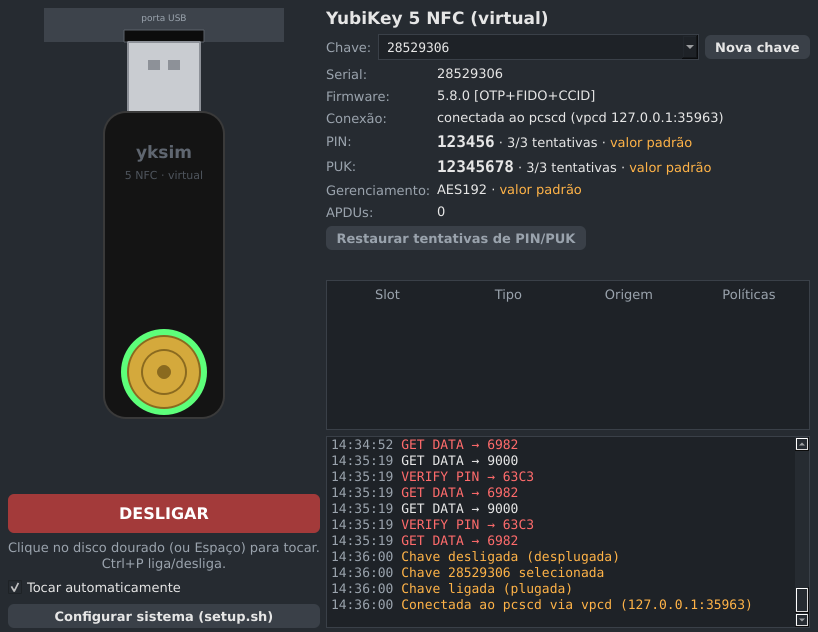
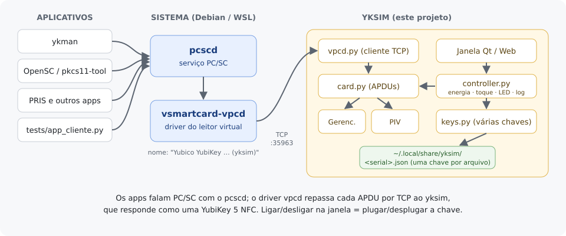
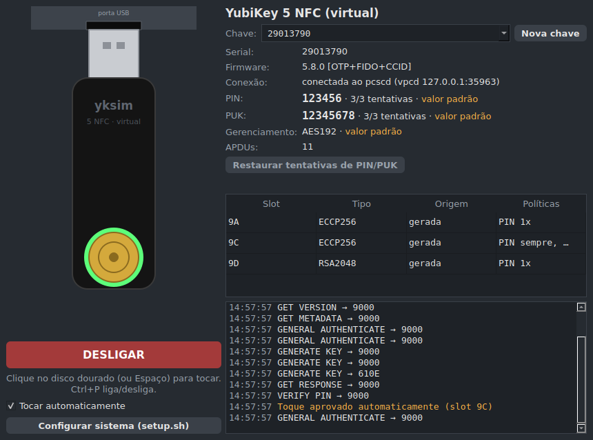
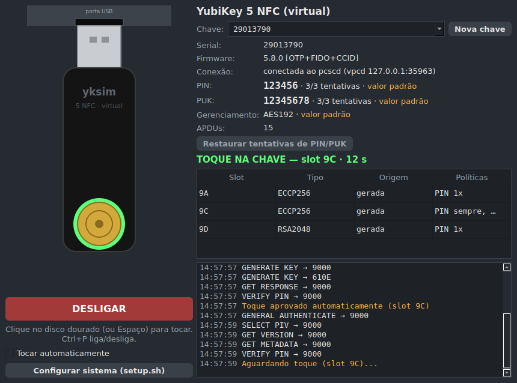
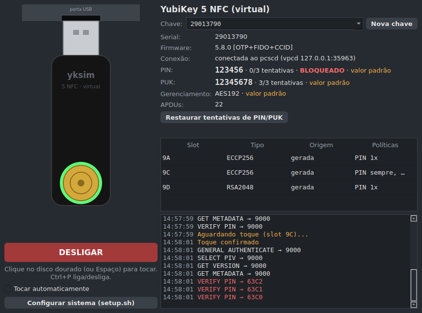
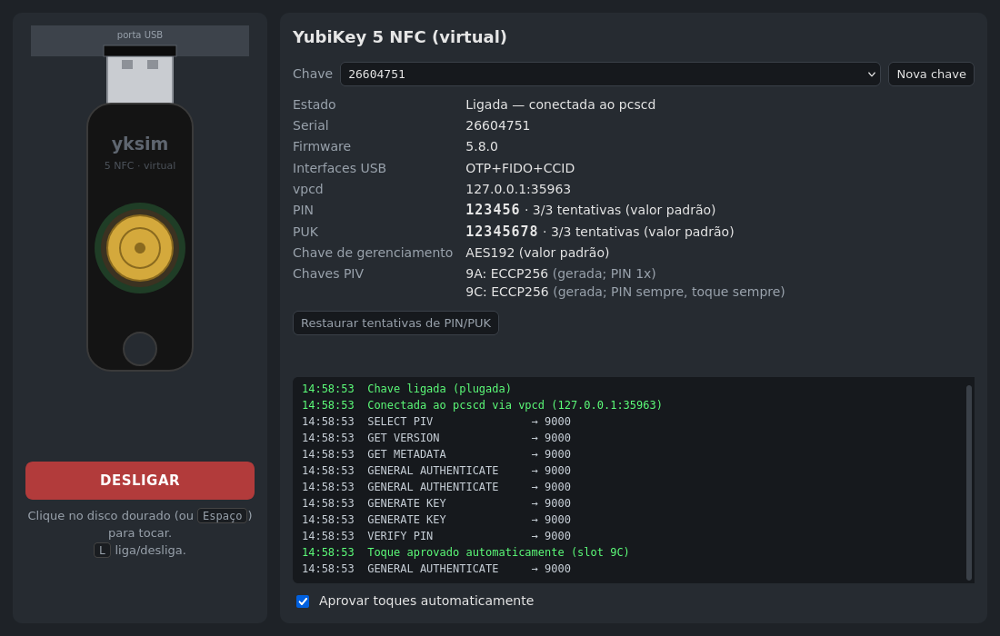
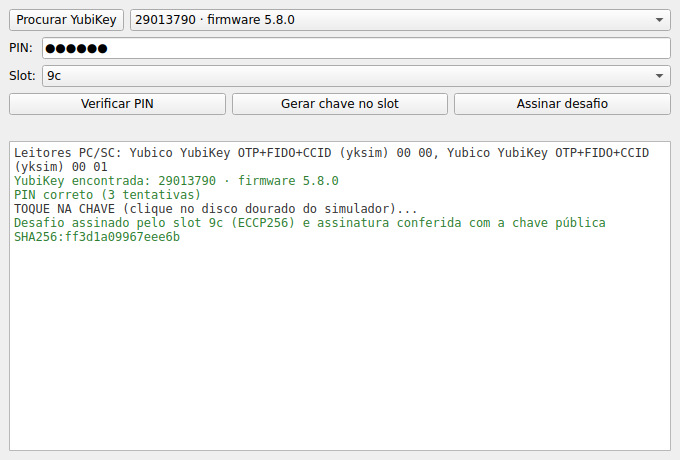

# yksim — simulador de YubiKey 5 NFC (5.8.0) com PIV

Uma YubiKey **virtual**, em Python, para desenvolver e testar aplicações que usam PIV/smart card sem precisar de
uma chave física. O `ykman`, o OpenSC (PKCS#11) e qualquer aplicativo PC/SC a enxergam como uma chave de verdade:

```
$ ykman list
YubiKey 5 NFC (5.8.0) [OTP+FIDO+CCID] Serial: 28529306
```



Funciona no **Debian** e no **Ubuntu do WSL2** (Windows).

📄 **Manual em PDF:** [docs/yksim-manual.pdf](docs/yksim-manual.pdf) (o mesmo conteúdo deste README, para imprimir ou
levar offline; refaça com `python3 docs/gerar_pdf.py`).

## Sumário

1. [Como funciona](#1-como-funciona)
2. [O que é emulado](#2-o-que-é-emulado)
3. [Dependências](#3-dependências)
4. [Instalação no Debian](#4-instalação-no-debian)
5. [Instalação no WSL2 (Windows)](#5-instalação-no-wsl2-windows)
6. [Primeiro uso](#6-primeiro-uso)
7. [Tutorial: chave PIV com o ykman e o OpenSC](#7-tutorial-chave-piv-com-o-ykman-e-o-opensc)
8. [Toque](#8-toque)
9. [PIN, PUK e bloqueio](#9-pin-puk-e-bloqueio)
10. [Várias chaves](#10-várias-chaves)
11. [Interface web](#11-interface-web)
12. [App cliente de teste](#12-app-cliente-de-teste)
13. [Linha de comando](#13-linha-de-comando)
14. [Uso em testes automatizados](#14-uso-em-testes-automatizados)
15. [Arquivos e dados](#15-arquivos-e-dados)
16. [Solução de problemas](#16-solução-de-problemas)

---

## 1. Como funciona



- Os aplicativos falam **PC/SC** com o serviço `pcscd`, como fariam com uma YubiKey USB.
- O driver **`vsmartcard-vpcd`** cria um leitor de cartão virtual dentro do `pcscd` e repassa cada comando (APDU)
  por TCP, na porta `127.0.0.1:35963`.
- O **yksim** se conecta a essa porta e responde como uma YubiKey 5 NFC com firmware 5.8.0.
- **LIGAR/DESLIGAR** na janela equivale a plugar ou desplugar a chave na porta USB.

O leitor virtual se chama `Yubico YubiKey OTP+FIDO+CCID (yksim)`. O nome importa: o `ykman` só lista leitores com
"Yubico YubiKey" no nome e deduz dele o modo `[OTP+FIDO+CCID]`.

## 2. O que é emulado

| Applet | Suporte |
|---|---|
| Gerenciamento | `ykman list` / `ykman info` (serial, firmware 5.8.0, form factor, capacidades USB/NFC), `ykman config usb/nfc` |
| PIV | PIN/PUK (contadores, bloqueio, desbloqueio, troca), chave de gerenciamento TDES/AES128/192/256 (padrão AES192, como no 5.7+), geração e importação RSA1024/2048/3072/4096, ECCP256/384, Ed25519, X25519, assinatura, decifração RSA, ECDH, políticas de PIN (NEVER/ONCE/ALWAYS) e de toque, metadados, atestação (F9), mover/apagar chave, objetos de dados (certificados, CHUID, objetos protegidos por PIN), reset, encadeamento de APDU e APDUs estendidas |

OTP e FIDO **não** são emulados: eles só aparecem como capacidades no `ykman info`.

**Limitações importantes**

- **Atestação:** é assinada por uma CA de **teste** gerada localmente, não pela CA da Yubico. Serviços que validam
  atestação genuína vão rejeitá-la, e isso é intencional.
- **Segurança:** as chaves privadas ficam **sem criptografia** em `~/.local/share/yksim/<serial>.json`
  (permissão 600). **Não use para chaves reais.**
- **Visibilidade:** a chave só existe para o Linux onde o `pcscd` roda. No WSL, os programas do Windows não a veem.
- **Toque:** é simulado (clique na janela, aprovação automática ou `--touch` no modo terminal).

## 3. Dependências

O `setup.sh` instala tudo isso. A tabela serve para conferir ou instalar à mão.

| Para quê | Debian 13 (trixie) | Ubuntu 24.04 no WSL2 |
|---|---|---|
| Serviço PC/SC | `pcscd` | `pcscd` |
| Leitor virtual | `vsmartcard-vpcd` | `vsmartcard-vpcd` (repositório *universe*) |
| Diagnóstico (`pcsc_scan`) | `pcsc-tools` | `pcsc-tools` |
| PKCS#11 (`pkcs11-tool`) | `opensc` | `opensc` |
| Python e venv | `python3`, `python3-venv` | `python3`, `python3-venv` |
| Janela Qt (padrão) | `python3-pyside6.qtwidgets` | PySide6 via `pip` no venv (o `setup.sh` faz isso) |
| Janela Tk (antiga) | `python3-tk` | `python3-tk` |
| Gerenciador de serviços | systemd (já vem) | systemd **ativado** no `/etc/wsl.conf` (seção 5) |
| Janela gráfica | X11/Wayland do desktop | WSLg (Windows 11, ou Windows 10 com `wsl --update`) |
| Abrir o navegador do Windows (opcional) | — | `wslu` (`wslview`) |

Bibliotecas Python (`requirements.txt`, instaladas no venv): `cryptography`, `yubikey-manager` (inclui o `ykman`),
`pyscard` e `pytest`. Se o `pip` precisar compilar o `pyscard`, instale também
`swig libpcsclite-dev build-essential python3-dev`.

## 4. Instalação no Debian

```bash
git clone https://github.com/naoimportaweb/yksim.git
cd yksim
./setup.sh
```

O `setup.sh` usa `sudo` para:

1. instalar os pacotes da seção 3;
2. renomear o leitor virtual em `/etc/reader.conf.d/vpcd` para `Yubico YubiKey OTP+FIDO+CCID (yksim)`
    (outro nome: `READER_NAME="..." ./setup.sh`);
3. tirar o `--auto-exit` do `pcscd`, que fazia o serviço encerrar após 60 s ocioso e "desplugar" a chave virtual;
4. reiniciar o `pcscd`.

Depois, sem `sudo`, ele cria a `.venv` do projeto (com `--system-site-packages`, para aproveitar o PySide6 do
sistema), instala as bibliotecas Python e cria o comando `yubikey` em `~/.local/bin`.

<details>
<summary>Instalação manual, sem o setup.sh</summary>

```bash
sudo apt-get install -y pcscd pcsc-tools vsmartcard-vpcd opensc python3-venv python3-tk python3-pyside6.qtwidgets
sudo sed -i 's|^FRIENDLYNAME .*|FRIENDLYNAME "Yubico YubiKey OTP+FIDO+CCID (yksim)"|' /etc/reader.conf.d/vpcd
sudo mkdir -p /etc/systemd/system/pcscd.service.d
printf '[Service]\nExecStart=\nExecStart=/usr/sbin/pcscd --foreground $PCSCD_ARGS\n' |
  sudo tee /etc/systemd/system/pcscd.service.d/yksim.conf
sudo systemctl daemon-reload && sudo systemctl restart pcscd.socket pcscd.service
python3 -m venv --system-site-packages .venv
.venv/bin/pip install -r requirements.txt
ln -sf "$PWD/bin/yubikey" ~/.local/bin/yubikey
```

</details>

## 5. Instalação no WSL2 (Windows)

**Pré-requisitos no Windows:** WSL2 com Ubuntu 24.04 e WSLg (já vem no Windows 11; no Windows 10, rode
`wsl --update` no PowerShell). Não é preciso `usbipd`: a chave é virtual, não há USB para repassar.

1. **Ative o systemd** (o `pcscd` depende dele). No Ubuntu do WSL:

    ```bash
    printf '[boot]\nsystemd=true\n' | sudo tee /etc/wsl.conf
    ```

    No **PowerShell**: `wsl --shutdown`. Depois abra o Ubuntu de novo e confira com
    `systemctl is-system-running` (aceita `running` ou `degraded`).

2. **Instale**, como no Debian:

    ```bash
    git clone https://github.com/naoimportaweb/yksim.git
    cd yksim
    ./setup.sh
    ```

    Se o systemd não estiver ativo, o `setup.sh` para no início e mostra o passo 1.

3. **Opcional — interface web no navegador do Windows:**

    ```bash
    sudo apt-get install -y wslu
    echo 'export BROWSER=wslview' >> ~/.bashrc
    ```

    Sem isso, abra `http://localhost:8765` no navegador do Windows manualmente.

## 6. Primeiro uso

Abra o simulador:

```bash
yubikey
```



O que observar:

- **LED** em volta do disco dourado:
    - apagado: desligada;
    - âmbar piscando: esperando o `pcscd`/`vpcd`;
    - verde: conectada (pisca a cada APDU);
    - verde piscando rápido: aguardando toque.
- **Conexão:** deve mostrar "conectada ao pcscd".
- **PIN e PUK** ficam sempre visíveis, com as tentativas restantes.
- **Log:** cada APDU recebida aparece com o código de resposta (`9000` = sucesso, em vermelho = erro).

Em outro terminal, confira que a chave aparece:

```bash
.venv/bin/ykman list
.venv/bin/ykman info
```

> Se houver uma YubiKey **física** conectada, use sempre `--device <serial>` nos comandos do `ykman`, para não
> mexer nela por engano.

## 7. Tutorial: chave PIV com o ykman e o OpenSC

Os valores padrão são **PIN `123456`**, **PUK `12345678`** e chave de gerenciamento
`010203040506070801020304050607080102030405060708` (AES192). Troque `SERIAL` pelo serial da sua chave virtual.

```bash
alias yk='.venv/bin/ykman --device SERIAL'

# 1. Estado do applet PIV
yk piv info

# 2. Gerar um par ECC P-256 no slot 9a (a chave privada nunca sai da "chave")
yk piv keys generate -a ECCP256 --pin-policy ONCE --touch-policy NEVER 9a pub.pem

# 3. Criar e gravar um certificado autoassinado para o slot (pede o PIN)
yk piv certificates generate -s "CN=teste yksim" 9a pub.pem

# 4. Atestação: prova que a chave foi gerada dentro do dispositivo
yk piv keys attest 9a att.pem
yk piv certificates export f9 f9.pem
.venv/bin/python -m yksim --serial SERIAL --export-ca ca.pem     # CA de teste desta chave
openssl verify -CAfile ca.pem -untrusted f9.pem att.pem          # att.pem: OK
```

Via PKCS#11, com o OpenSC (o slot 9a é o objeto de ID `01`):

```bash
P11=/usr/lib/x86_64-linux-gnu/opensc-pkcs11.so
pkcs11-tool --module $P11 -L                     # lista o leitor e o token
pkcs11-tool --module $P11 -O                     # lista certificados e chaves
echo "olá" > msg.txt
pkcs11-tool --module $P11 --login --pin 123456 --sign -m ECDSA-SHA256 --id 01 -i msg.txt -o assinatura.bin
```

## 8. Toque

Uma chave gerada com `--touch-policy ALWAYS` (ou `CACHED`) exige um toque a cada uso. Quando isso acontece, a
janela mostra **TOQUE NA CHAVE**, o slot e a contagem regressiva de 15 s, e o LED pisca rápido:



- Clique no **disco dourado** ou aperte **Espaço**.
- Sem toque em 15 s, a operação falha, como na chave física.
- `CACHED` dispensa um novo toque por 15 s.
- **Tocar automaticamente** aprova todos os toques (útil em testes repetitivos).

## 9. PIN, PUK e bloqueio

Três PINs errados bloqueiam o PIN, como numa YubiKey real. A janela mostra **BLOQUEADO** em vermelho:



- **Pelo caminho real:** `ykman piv access unblock-pin -u 12345678 -n 123456` (usa o PUK).
- **Atalho do simulador:** o botão **Restaurar tentativas de PIN/PUK** volta os contadores ao máximo e
  desbloqueia PIN e PUK, sem mudar os valores. Numa chave física isso não existe: um PUK bloqueado não tem volta.
- Trocar os valores: `ykman piv access change-pin` e `ykman piv access change-puk`. A janela mostra os valores
  novos e para de indicar "valor padrão".

## 10. Várias chaves

Cada chave virtual é um arquivo `~/.local/share/yksim/<serial>.json`, e só uma fica "plugada" por vez (há um
único leitor virtual).

- **Chave:** o seletor no topo da janela troca a chave no leitor. É como tirar uma YubiKey da porta e colocar
  outra: o `pcscd` vê a remoção e a inserção.
- **Nova chave:** cria uma chave com serial **aleatório de exatamente 8 dígitos**, sem repetir um existente,
  com sua própria CA de atestação de teste.
- A janela abre na **última chave usada**. `yubikey --serial 12345678` abre (ou cria) uma chave específica.
- Pelo terminal: `.venv/bin/python -m yksim --list` e `.venv/bin/python -m yksim --new`.
- Apagar: `rm ~/.local/share/yksim/<serial>.json`, com o simulador fechado.

## 11. Interface web

`yubikey --web` abre a mesma interface no navegador, em `http://localhost:8765`:



Ela tem os mesmos controles da janela Qt, com uma diferença: **L** liga/desliga em vez de Ctrl+P. Escuta só
em `127.0.0.1` e exige requisições JSON, para que um site aberto no navegador não consiga mexer na chave.

> A porta 8765 é a mesma da API do MCP do painel PRIS: não use os dois ao mesmo tempo. A janela Qt não abre
> porta nenhuma, então é a opção mais segura.

O botão **Configurar sistema (setup.sh)** existe só na janela Qt. Ele roda o `setup.sh` e mostra a saída no log,
mas só quando o `sudo` funciona sem senha; caso contrário, rode `./setup.sh` no terminal.

## 12. App cliente de teste

`tests/app_cliente.py` é um aplicativo Qt que **pede a YubiKey** como um app real faria, só pelo `pcscd`. Serve
para conferir o simulador de ponta a ponta:

```bash
python3 tests/app_cliente.py      # com o simulador aberto e ligado
```



1. **Procurar YubiKey:** lista os leitores PC/SC e as chaves que responderam.
2. **Verificar PIN:** confere o PIN e mostra as tentativas restantes.
3. **Gerar chave no slot:** ECC P-256 com PIN e toque sempre exigidos (usa a chave de gerenciamento padrão).
    Atenção: sobrescreve o que houver no slot.
4. **Assinar desafio:** assina 32 bytes aleatórios e confere a assinatura com a chave pública do slot. Se o slot
    exigir toque, toque no simulador.

Ele não é um teste do `pytest` e não roda junto com `pytest tests`.

## 13. Linha de comando

**Comando `yubikey`** (criado pelo `setup.sh`):

```bash
yubikey              # janela Qt em segundo plano (log em ~/.local/state/yksim/gui.log)
yubikey --fg         # idem, preso ao terminal, com logs
yubikey --web        # interface no navegador (http://localhost:8765)
yubikey --tk         # janela Tk (antiga; não troca de chave)
yubikey --terminal   # sem interface
yubikey --off        # abre com a chave desligada
yubikey --serial N   # abre a chave N (8 dígitos; cria se não existir)
yubikey --stop       # fecha
```

**Modo terminal** (`python -m yksim`):

| Opção | Efeito |
|---|---|
| `--serial N` | abre a chave N; cria se não existir (exatamente 8 dígitos) |
| `--new` | cria uma chave com serial aleatório |
| `--list` | lista as chaves e sai |
| `--dir DIR` | diretório das chaves (padrão `~/.local/share/yksim`) |
| `--state ARQ` | usa um arquivo avulso, fora do diretório de chaves |
| `--touch auto\|deny\|prompt` | como responder a pedidos de toque |
| `--export-ca ARQ` | grava a CA de atestação de teste e sai |
| `-v` / `-vv` | log; `-vv` mostra cada APDU e os comandos do vpcd |

A janela e o modo terminal usam os mesmos arquivos de chave: não rode os dois ao mesmo tempo.

## 14. Uso em testes automatizados

Para testes, não é preciso `pcscd`: o `SimConnection` liga o `yubikit` direto ao simulador, em memória.

```python
from yksim import open_sim
from yksim.testing import SimConnection
from yubikit.piv import PivSession, DEFAULT_MANAGEMENT_KEY, SLOT, KEY_TYPE

piv = PivSession(SimConnection(open_sim()))  # só em memória; serial aleatório de 8 dígitos
piv.authenticate(DEFAULT_MANAGEMENT_KEY)
pub = piv.generate_key(SLOT.AUTHENTICATION, KEY_TYPE.ECCP256)
```

```bash
.venv/bin/python -m pytest -q tests                              # todos
.venv/bin/python -m pytest -q tests/test_sim.py::test_pin_flow   # um só
```

## 15. Arquivos e dados

| Caminho | Conteúdo |
|---|---|
| `~/.local/share/yksim/<serial>.json` | uma chave: serial, PIN/PUK e contadores, chave de gerenciamento, chaves privadas de cada slot (PEM, **sem criptografia**), objetos PIV e a CA de teste. Permissão 600. |
| `~/.local/state/yksim/gui.log` | saída do simulador quando aberto com `yubikey` em segundo plano |
| `/etc/reader.conf.d/vpcd` | configuração do leitor virtual (nome alterado pelo `setup.sh`) |
| `/etc/systemd/system/pcscd.service.d/yksim.conf` | `pcscd` sem `--auto-exit` |

Recomeçar do zero: `yubikey --stop && rm ~/.local/share/yksim/*.json`.

## 16. Solução de problemas

| Sintoma | Causa provável e solução |
|---|---|
| LED âmbar piscando sem parar | O `vpcd` não está instalado ou o `pcscd` não está rodando. Rode `./setup.sh` e confira `systemctl status pcscd`. |
| `ykman list` vazio, mas `pcsc_scan` mostra o leitor | O nome do leitor não contém "Yubico YubiKey". Rode `./setup.sh` de novo (ou ajuste `FRIENDLYNAME` em `/etc/reader.conf.d/vpcd`) e reinicie o `pcscd`. |
| A chave "some" depois de um minuto parada | `pcscd` com `--auto-exit`. O `setup.sh` remove essa opção. |
| `Card is unpowered` ou "nenhuma YubiKey respondeu", com o leitor visível | Visto quando outro programa PC/SC usa o cartão ao mesmo tempo (por exemplo o OpenSC carregado pelo navegador ou pelo `gnome-keyring`). Clique em **DESLIGAR** e **LIGAR** no simulador e tente de novo. |
| O `setup.sh` para dizendo que o systemd não está ativo (WSL) | Ative o systemd (seção 5, passo 1) e rode `wsl --shutdown`. |
| A janela não abre no WSL | Falta o WSLg: atualize com `wsl --update` e confira `echo $DISPLAY`. Como alternativa, use `yubikey --web`. |
| Programas do Windows não veem a chave | Esperado: a chave só existe dentro do Linux do WSL. |
| **Configurar sistema** diz que o `sudo` pede senha | O botão não tem onde digitar a senha. Rode `./setup.sh` no terminal. |
| `yubikey --web` não abre ou dá erro de porta | A porta 8765 está em uso (por exemplo pelo painel PRIS). Feche o outro programa ou use a janela Qt. |
